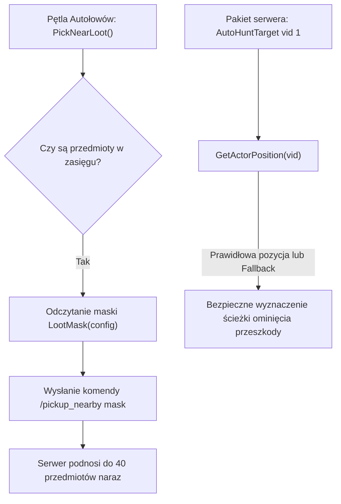

# Szybkie Zbieranie Dropu w Autołowach + Fix Crashy (Fast Area Pickup & Crash Fix)

Zaawansowana modyfikacja modułu Autołowów (`uiautohunt.py`) integrująca szybkie zbieranie obszarowe oraz eliminująca krytyczny błąd zawieszania się logiki celowania.

---

## 🚀 Główne Ulepszenia

1. **Błyskawiczne Zbieranie Obszarowe (`/pickup_nearby`)**:
   - Tradycyjne autołowy podchodziły do każdego przedmiotu z osobna i wysyłały pojedyncze pakiety podnoszenia (`SendItemPickUpPacket`).
   - Modyfikacja wysyła komendę szybkiego zbierania obszarowego z uwzględnieniem maski filtrowania skonfigurowanej w oknie Autołowów. Cały drop w promieniu postaci podnoszony jest natychmiast!

2. **Krytyczny Fix Zawieszania Się Autołowów (`TypeError: NoneType`)**:
   - **Problem:** Gdy serwer wysyłał pakiet `AutoHuntTarget <vid> 1` (oznaczający cel zablokowany przez przeszkodę), klient wywoływał `chr.GetPixelPosition(vid)`. Dla bytów na skraju renderowania funkcja zwracała `None`, powodując nieobsłużony błąd Pythona i całkowity paraliż Autołowów.
   - **Rozwiązanie:** Wdrożono bezpieczny adapter `GetActorPosition(vid)` z obsługą wyjątków, fallbackiem do `textTail` oraz współrzędnych gracza, gwarantując 100% stabilności.

---

## 🛠️ Architektura Działania (Diagram)



---

## 📁 Struktura Paczki

```text
Szybkie_Zbieranie_Autolowy/
├── INSTALUJ_AUTOMATYCZNIE.bat                  # 1-klikowy automatyczny instalator Windows
├── install_vps.sh                              # Skrypt instalacyjny pomocniczy
├── INSTRUKCJA_PL.txt                           # Instrukcja krok po kroku
├── INSTRUKCJA_VPS.md                           # Poradnik dla serwera / autopatchera
├── README.md                                   # Pełna dokumentacja modułu
└── klient_pliki/
    ├── apply_autohunt_fastpickup_fix_client.py # Skrypt patchujący klienta
    └── root/
        └── uiautohunt.py                       # Gotowy, w 100% przetestowany plik Autołowów
```
