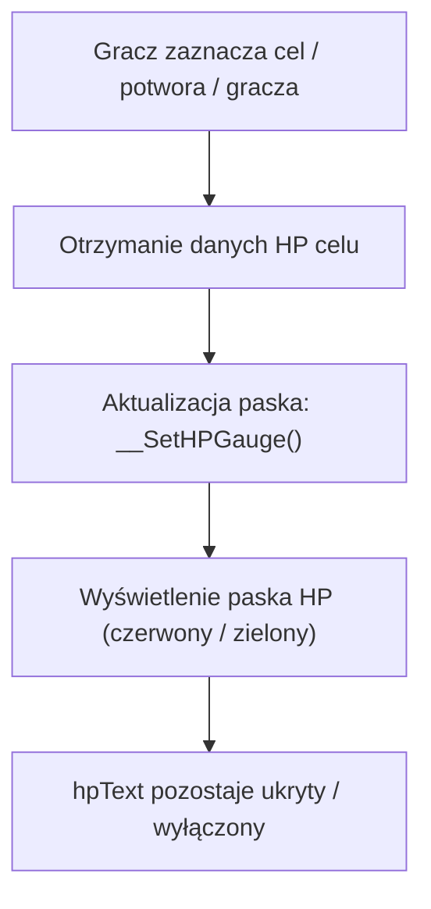

# Ukrycie Liczbowej Wartości HP Celu (Hide Target HP Numbers)

Modyfikacja interfejsu klienta usuwająca biały tekst z dokładną liczbą punktów życia celu (np. `100 / 100`, `35400 / 52000`).
Na ekranie pozostaje estetyczny, czysty i dynamiczny pasek zdrowia (HP bar), zachowując klasyczny klimat gry.

---

## 🚀 Główne Zalety
- **Estetyka i Czystość UI**: Brak zasłaniającego pasek białego tekstu z cyframi.
- **Płynność i Spójność**: Czerwony pasek HP (oraz zielony przy zatruciu) nadal dokładnie odzwierciedla stan zdrowia przeciwnika.
- **Zero obciążenia serwera**: Modyfikacja czysto wizualna po stronie klienta gry.

---

## 🛠️ Architektura Działania (Diagram)



---

## 📁 Struktura Paczki

```text
Ukrycie_Wartosci_HP_Celu/
├── INSTALUJ_AUTOMATYCZNIE.bat           # 1-klikowy automatyczny instalator Windows
├── install_vps.sh                       # Skrypt pomocniczy
├── INSTRUKCJA_PL.txt                    # Instrukcja krok po kroku
├── INSTRUKCJA_VPS.md                    # Instrukcja przygotowania paczki do patchera
├── README.md                            # Dokumentacja modułu
└── klient_pliki/
    ├── apply_hide_target_hp_client.py   # Skrypt patchujący klienta
    └── root/
        └── uitarget.py                  # Gotowy zmodyfikowany plik interfejsu celu
```
