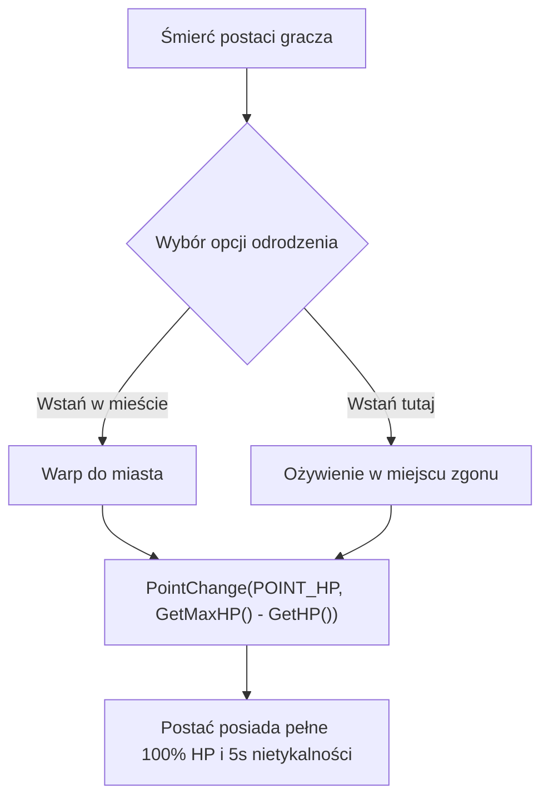

# Wstawanie po Śmierci z 100% HP (Revive with 100% HP)

Modyfikacja serwerowa usuwająca archaiczny mechanizm wstawania z 50 punktami życia i konieczności mozolnego leczenia miksturami po każdym zgonie.

---

## 🚀 Główne Zalety
- **100% HP po wciśnięciu „Wstań w mieście” (`SCMD_RESTART_TOWN`)**: Gracz nie musi tracić czasu w bezpiecznej strefie na potowanie.
- **100% HP po wciśnięciu „Wstań tu i teraz” (`SCMD_RESTART_HERE`)**: Gotowość do natychmiastowego powrotu do walki / expienia.
- **100% HP po relogu / ekranie wyboru postaci (`CHARACTER::Disconnect`)**: Postać logująca się ponownie nie zostaje na skraju śmierci.

---

## 🛠️ Architektura Działania (Diagram)



---

## 📁 Struktura Paczki

```text
Wstawanie_100_Procent_HP/
├── INSTALUJ_AUTOMATYCZNIE.bat      # 1-klikowy automatyczny instalator Windows
├── install_vps.sh                  # 1-klikowy instalator Linux VPS
├── INSTRUKCJA_PL.txt               # Instrukcja krok po kroku
├── INSTRUKCJA_VPS.md               # Poradnik dla administratorów VPS
├── README.md                       # Dokumentacja modułu
└── serwer_cpp/
    ├── apply_revive_100_hp_server.py # Skrypt patchujący kod C++
    └── revive_100_hp.diff          # Unified diff dla źródeł C++
```
